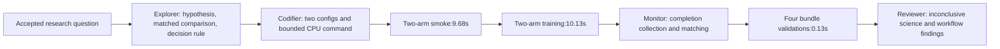

# Result: exp-002

## Evidence and coverage

Two smokes and two production arms completed. Both production arms have four ordered finite epoch records and report optimizer_steps_applied=true. The resolved budget implies32 updates per arm (eight batches per epoch); no independent cumulative step counter was present in the inspected metrics. Smokes each have one update. The resolved evaluation budget is one sixteen-example fixed validation batch per epoch. No per-epoch duration fields were present in metrics.json. All bundles report official_test_read=false and zero official-test evaluations. Numeric best/final checkpoint weight arrays are finite; string metadata arrays were excluded from the numeric check. No experiment failures, retries, exclusions or replacements. Unexecuted exp-001 is not a replicate.

[Monitor evidence](../../../../../results/experiment-loop-tiny-audit-20260925-v1/analysis/monitor.json) records full paths, config and checkpoint hashes, runtime identity, exact validation commands and output. All four validate-run calls passed once each in 0.130698s total measured subprocess time. Source commit `6be7d41038018b225cef7d1771fdb905084b0db7` is dirty; source hashes accompany phase invocations. Python3.12.12, CPU, nom-cool-2.

| Arm | Kind | Bundle |
|---|---|---|
| baseline | smoke | `results/experiment-loop-tiny-audit-20260925-v1/smoke/000_workflow_tiny_baseline_20260925_d0701b88` |
| baseline | run | `results/experiment-loop-tiny-audit-20260925-v1/000_workflow_tiny_baseline_20260925_d0701b88` |
| ours | smoke | `results/experiment-loop-tiny-audit-20260925-v1/smoke/001_workflow_tiny_ours_20260925_865c669f` |
| ours | run | `results/experiment-loop-tiny-audit-20260925-v1/001_workflow_tiny_ours_20260925_865c669f` |

All four initial parameter hashes match `4e095eacfa44c0b397fd6ca41f5ee754e653f1e736aba85677e2835a7328762d`. Both split hashes and every epoch-order hash match across arms: four for production and one for smoke. Full hashes remain in monitor.json.

## Measurements

| Arm | Epoch | Validation loss | Validation accuracy |
|---|---:|---:|---:|
| baseline | 1 | 0.500143170357 | 0.0625 |
| baseline | 2 | 0.499272197485 | 0.0625 |
| baseline | 3 | 0.498253196478 | 0.0625 |
| baseline | 4 | 0.497147202492 | 0.0625 |
| ours | 1 | 0.500707030296 | 0.0625 |
| ours | 2 | 0.498545110226 | 0.0625 |
| ours | 3 | 0.496030867100 | 0.0625 |
| ours | 4 | 0.493304103613 | 0.0625 |

## Monitor audit

Ready for review: 2026-09-25T12:11:51.440850+00:00. First output observation12:09:27.302366Z followed production end12:09:12.609772Z: completion-only handoff. Preparation observed12:07:52Z overlapped coordinator work. Five execution-tool command batches covered preparation, one inspection, four validations, and extraction/writing; one extraction failed on nonnumeric checkpoint metadata. Two overly verbose output batches were truncated. No validation repeats or active-run polling. Exact counts, timing bounds and friction are in monitor.json. Token usage and inference/tool-latency decomposition are unknown.

## Interpretation

H-002 is **inconclusive under the frozen rule**. Baseline loss fell 0.5990% between step8 and step32; ours fell 1.4785%. The contrast is **+0.8795 percentage points**, below the required strict +2pp support threshold. Accuracy stayed6.25% for both. Direction favors ours in this one tiny trajectory, but this is not general amplification evidence, statistical equivalence, or an initialization-to-final comparison. Sixteen validation examples, one seed,32 updates, fixed raw Adam rates and finite T/K limit the claim. Both outcomes are retained.

H-001 is **supported for this pilot**: design-to-review elapsed 298.039s, of which smoke+production occupied 19.818s and the remaining 278.221s (93.4%) was outside those invocations. This elapsed remainder includes agent work, tool/communication latency, campaign scaffolding, audit instrumentation, extraction and waiting; it is not all wasted time, nor pure model inference cost. User discussion and superseded exp-001 are outside this window. No tokens or monetary costs were measured.

## Observed workflow model

The coordinator performed Explorer/Codifier/Reviewer; one additional agent performed Monitor. Its first observation was14.69s after production completion, so this exercised a completion handoff, not live detection of a stalled process. No synthetic delay was added. The cancelled first Monitor assignment and one-arm proposal are evidence that implementation started prematurely, not experimental replicates.

| Phase / operation | Measured wall time | Interpretation |
|---|---:|---|
| Frozen design → first smoke start | 47.665s | Config/command preparation and delegation |
| Both one-step smokes | 9.685s | Includes two trainer process starts, data and reporting |
| Smoke end → production start | 38.130s | Semantic check, command preparation, interaction latency |
| Both32-step training arms | 10.133s | Includes two trainer process starts, data and reporting |
| Production end → Monitor ready | 158.831s | Collection/extraction/write-up; includes0.131s validation |
| Monitor ready → Reviewer start | 33.594s | Handoff/review scheduling |

These rows partition elapsed time; Monitor preparation overlapped earlier work and is not added again. Exact per-epoch durations were unavailable; epoch-record timestamps alone do not isolate training kernels. The dashboard refresh was0.792s and overlaps the collection interval. Manual event `monitor_handoff_sent` was recorded after dispatch and is not used to infer latency.

## Prioritized improvements

1. **Establish the question before implementation.** The user had to correct the initial order. A short Explorer handoff should contain question, hypothesis, comparison, measurement and decision rule before config work or delegation.
2. **Add an explicit short-run path.** For bounded runs lasting seconds, allow the coordinating agent to execute, observe and collect directly. The separate Monitor added no live coverage here. Keep a separate monitoring owner for long/detached experiments and incidents.
3. **Make the real tiny run its execution smoke where appropriate.** The separate smoke took 48.9% of combined invocation wall time. Preserve finite guards, real optimizer/evaluation execution, timeout and terminal validation. Retain a separate smoke before substantial compute or risky deployment; this is a proposed policy change, not one applied to this baseline.
4. **Use compact role handoffs and selective reads.** Monitor made five command batches, two verbose outputs were truncated, and numeric extraction failed once on string NPZ metadata. Reviewer repeated the verbose-read mistake. Hand off the small coverage/matching/metric summary and paths, then read individual fields only for unresolved questions. Canonical validation itself took only0.131s, so weakening it would save little.
5. **Reduce pilot paperwork and optional exports.** The campaign template requires multiple notes plus ledger; a single-note pilot could grow into a campaign later. Four tiny bundles emitted72 regular files totaling727035bytes; legacy NPY/NPZ exports and TensorBoard are candidates for an optional lightweight output mode after consumer review. No export-time savings were measured, and this is lower priority here.

Already useful: current retirement of T/K/rho/CIFAR scientific launch gates was respected; no calibration, gradient replay, remote check or GPU allocation occurred. The runner's existing initial/split/all-epoch-order hashes removed the need for extra matching replay. No scientific failure was rerun; terminal validations were done once per bundle. One global dashboard refresh was sufficient because the run completed before handoff observation. The17 campaign-structure tests took0.019s; they are not a meaningful runtime bottleneck.

## Limits and next decision

The baseline is complete. Keep research-question-first ordering immediately; other changes are recommendations pending a separate implementation task. A useful next workflow comparison would rerun this exact frozen pair under an explicitly approved short-run path and compare non-overlapping phase times, retaining matching and canonical validation. No further experiment is launched by this recommendation.

Current exact_run source metadata includes a commit, dirty boolean and optional archive hash, not automatic fingerprints of all dirty files. This pilot separately records four relevant file hashes for smoke and production, but does not claim a complete frozen source archive. The performance audit is local-only: SSH, Slurm, remote staging, runtime recovery, real stalls and long-run monitoring were not tested.

Machine-readable [timing and scientific summary](../../../../../results/experiment-loop-tiny-audit-20260925-v1/analysis/summary.json), [event log](../../../../../results/experiment-loop-tiny-audit-20260925-v1/analysis/events.jsonl), [observations](../../../../../results/experiment-loop-tiny-audit-20260925-v1/analysis/workflow_observations.json) and [artifact inventory](../../../../../results/experiment-loop-tiny-audit-20260925-v1/analysis/artifact_inventory.json) preserve the audit trail. Learning curves and arm summaries are in analysis/*.csv. This result note is the sole combined factual/scientific/workflow review.

Closeout timing: review/analysis/record updates took 161.818s after review started; frozen design through closeout took 459.856s. This adds to, rather than being hidden inside, the pre-review H-001 measurement. Earlier research-question discussion/design and superseded exp-001 are not included in this timed span. Final campaign ledger check, result-link checks and git diff whitespace check passed; existing17 campaign tests passed during preparation. No simulator source was changed for this pilot.
